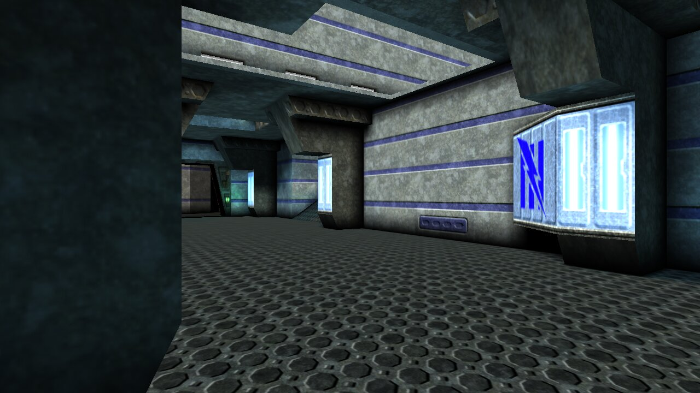

# OpenUT99-Plus

<p align="center"></p>


[Español](README.es.md) · [English](README.md) · [Português](README.pt.md) · [Français](README.fr.md) · **Deutsch** · [Русский](README.ru.md)

**Unreal Tournament auf einer neuen Engine.** OpenUT99-Plus ist eine unabhängige, von Grund auf neu geschriebene Reimplementierung der Unreal Engine 1, der Engine von Unreal Tournament (1999). Sie liest die Dateien des Spiels aus deiner Installation und führt sie auf heutigen Systemen aus, einschließlich des UnrealScript-Codes des Spiels. Das langfristige Ziel ist, mit und gegen das Originalspiel zu spielen: Originalclients auf unserem Server und unser Client auf Originalservern.

<table>
  <tr>
    <td></td>
    <td></td>
  </tr>
  <tr>
    <td colspan="2"></td>
  </tr>
</table>
<p align="center"><sub>DM-Curse][, CTF-Coret und DM-Morpheus, von OpenUT99-Plus aus den Spieldateien gezeichnet, während Bots die Partie spielen.</sub></p>

## Was heute funktioniert

- **Jedes Objekt der Installation wird bytegenau dekodiert**: alle 396 Pakete mit ihren Karten, Texturen, Sounds, Musik, Schriften, Meshes, Animationen und dem UnrealScript-Bytecode, gelesen von den Python-Werkzeugen und mit der C++-Engine abgeglichen.
- **Alle 83 Karten laden und werden gezeichnet**: texturierter BSP, vorberechnete Lightmaps, Himmel, Dekorationen, Gegenstände und animierte Figuren.
- **Das UnrealScript des Spiels läuft**: unsere virtuelle Maschine führt alle 1.604 Klassen des Spiels aus. Sie startet auf jeder Karte ein Deathmatch ohne einen einzigen Skriptfehler. Bots folgen dem Wegenetz, öffnen Türen, fahren mit Aufzügen, sammeln Waffen und Gegenstände, kämpfen gegeneinander, sterben, punkten und kehren zurück.
- **Physik am Original gemessen**: unsere eigenen Sondenskripte laufen auf dem originalen Dedicated Server und zeichnen genau auf, wie sich Pawns bewegen ([ADR 0008](docs/architecture/adr/0008-probe-the-original.md)). Stufen, begehbare Rampen, Rutschen an steilen Hängen, die Wandgrenze und der Sprung auf Kanten stimmen mit dem Original überein; der Beginn einer Rutschpartie noch nicht.

> [!NOTE]
> **Forschungsphase.** Es gibt noch keine Spielersteuerung: Du kannst durch jede Karte fliegen oder den Bots beim Spielen zusehen. Noch gibt es keinen Ton, kein HUD, keine Menüs und kein Netzwerk, und ein großer Teil der Physik und KI ist noch provisorisch ([bekannte Schulden](docs/roadmap/debt.md)).

> [!IMPORTANT]
> **Es sind keine Spielinhalte enthalten – bring deine eigenen Daten mit.** Dieses Repository enthält nur Quellcode: keine Pakete, Karten, Texturen, Sounds, Musik oder ausführbaren Dateien. Die Engine liest sie aus einer Kopie von Unreal Tournament, die **du rechtmäßig besitzt**, hier `<UT99_DIR>` genannt. Getestet mit der Steam-Version und dem 469f-Patch von [OldUnreal](https://www.oldunreal.com/).

## Ausprobieren

Fertige Builds gibt es noch nicht. Baue die Engine (siehe [Bauen](#bauen)) und gib ihr deinen Unreal-Tournament-Ordner an, den mit `Maps/` und `System/`:

```sh
build/ut_mapview "<UT99_DIR>" DM-Deck16][                    # durch eine Karte fliegen
build/ut_mapview "<UT99_DIR>" DM-Morpheus --play --follow    # den Bots zusehen und einem folgen
build/ut_script "<UT99_DIR>" --map DM-Codex 60               # ohne Fenster: eine Minute einer Partie, ausgegeben
```

| Steuerung | |
|---|---|
| Umsehen | Maustaste halten und ziehen, oder die Pfeiltasten |
| Fliegen | WASD, Shift ist schneller |
| Beim Zusehen | F folgt dem nächsten Bot; Esc beendet |

## Fahrplan

Reihenfolge und Abschlusskriterien stehen in [docs/roadmap/roadmap.md](docs/roadmap/roadmap.md):

1. **Pakete und Objekte** (erledigt): jedes Objekt jedes Pakets ohne übrige Bytes gelesen.
2. **Level-Betrachter** (erledigt): jede Karte des Spiels in der C++-Engine.
3. **Spielablauf** (in Arbeit): Akteure, Physik, Waffen, Bots und Spielmodi, bis zu einem Deathmatch gegen Bots.
4. **Originaltreue**: Vergleich Seite an Seite mit dem Original.
5. **Netzwerk**: ein Originalclient verbindet sich mit unserem Server, und unser Client mit einem Originalserver.

## Mitmachen

Jede Hilfe zählt: ausprobieren und melden, was nicht stimmt, mit dem Originalspiel vergleichen, oder Code. Die technische Dokumentation, auf Englisch, beginnt bei [docs/README.md](docs/README.md): Dateiformate, Architekturentscheidungen und bekannte Schulden. [AGENTS.md](AGENTS.md) ist der Einstiegspunkt für KI-Programmieragenten.

## Bauen

C++17, CMake, SDL2 und OpenGL 3.3 (libepoxy). Unter Debian oder Ubuntu:

```sh
sudo apt install cmake g++ git pkg-config libsdl2-dev libepoxy-dev
cmake -S . -B build && cmake --build build -j
ctest --test-dir build
# -> build/ut_mapview (Fenster), build/ut_script (ohne Fenster), build/ut_dump (Paketinspektor)
```

<details>
<summary><b>Python-Werkzeuge</b></summary>

Leser für die Formate des Spiels, nur mit der Standardbibliothek von Python 3.

```sh
python3 tools/upkg.py "<UT99_DIR>/Maps/DM-Deck16][.unr"        # Header, Namen, Imports, Exports
python3 tools/uprops.py --sweep "<UT99_DIR>"                     # jedes Objekt lesen, Zählung pro Klasse
python3 -m unittest discover -s tools                            # Tests
python3 tools/check_docs.py                                      # Dokumentationsprüfung
```

</details>

<details>
<summary><b>Was liegt wo</b></summary>

| Pfad | Inhalt |
|---|---|
| `engine` | Die C++-Engine: Pakete, Level, Kollision, die UnrealScript-VM, die Welt (Physik, KI, Mover), der Renderer und die ausführbaren Programme |
| `tools` | Python-Leser für die Formate, die Sonde, die das Original vermisst, die Dokumentationsprüfung und ihre Tests |
| `docs/formats` | Die Spezifikationen der Dateiformate |
| `docs/architecture` | Schichten, Grenzen und die Architekturentscheidungen (ADRs) |
| `docs/roadmap` | Der Fahrplan und die bekannten Schulden |
| `docs/ai` | Die Gedächtnisschicht für KI-Agenten |

</details>

## Transparenz

- **Wer es pflegt:** OpenGamePlus. Ich mag alte Spiele und möchte Unreal Tournament mit Freunden auf heutigen Systemen weiterspielen, mit einer offenen Engine, die die Community am Leben halten kann.
- **Wie gearbeitet wird:** Ich arbeite mit [Claude Code](https://claude.com/claude-code), dem Programmierassistenten von Anthropic. Code und Dokumentation, einschließlich dieser README und ihrer Übersetzungen, entstehen mit seiner Hilfe. So entstandene Commits tragen eine Zeile `Co-Authored-By: Claude` in ihrer Nachricht und lassen sich im Verlauf mit `git log` erkennen.
- **Originalcode:** Kein Code der Original-Engine wird in dieses Repository kopiert, und ihre nativen Binärdateien werden nicht disassembliert. Die Engine entsteht aus den Datendateien des Spiels, aus dem UnrealScript des Spiels (gelesen, um das Verhalten zu verstehen, nie kopiert), aus der Beobachtung des laufenden Originalspiels und aus öffentlicher Dokumentation ([ADR 0004](docs/architecture/adr/0004-clean-room-sources.md)).
- **Was es nicht ist:** Es ist kein offizielles Projekt und nicht mit Epic Games verbunden. Es enthält keine Spieldateien.

## Hinweis

Dies ist eine unabhängige Reimplementierung der Unreal Engine 1. Sie ist nicht mit Epic Games, Inc. oder einem seiner verbundenen Unternehmen verbunden und wird von ihnen weder autorisiert noch gesponsert oder unterstützt.

„Unreal“ und „Unreal Tournament“ sind Marken von Epic Games, Inc. Sie werden in diesem Repository nur zur Identifikation und Interoperabilität verwendet, um zu beschreiben, was die Engine ausführt. Es wird kein Anspruch auf diese Marken erhoben.

Dieses Projekt stellt keine urheberrechtlich geschützten Spieldaten bereit und hilft nicht, sie zu beschaffen. Um es mit echten Spielinhalten zu nutzen, musst du die Datendateien einer rechtmäßig erworbenen Kopie von Unreal Tournament bereitstellen.

Wenn du Rechteinhaber bist und meinst, dass etwas hier nicht verbreitet werden sollte, eröffne bitte ein Issue oder kontaktiere den Maintainer; es wird umgehend bearbeitet.

Die Screenshots zeigen Inhalte von Unreal Tournament, Eigentum von Epic Games, Inc., nur zur Identifikation.

## Lizenz

[GNU Affero General Public License v3.0](LICENSE). Wer die Engine verbreitet oder eine veränderte Version als Netzwerkserver für andere betreibt, muss ihren Quellcode unter derselben Lizenz anbieten. Bibliotheken Dritter behalten ihre eigenen: SDL2 (zlib) und libepoxy (MIT).

## Danksagung

- [SDL](https://www.libsdl.org/) und [libepoxy](https://github.com/anholt/libepoxy)
- [OldUnreal](https://www.oldunreal.com/), die Unreal Tournament mit ihren Patches am Leben halten
- [ut99-mapgen](https://github.com/monteslu/ut99-mapgen) (MIT), zum Bauen der Kalibrierkarten
- Epic Games, für das Spiel
