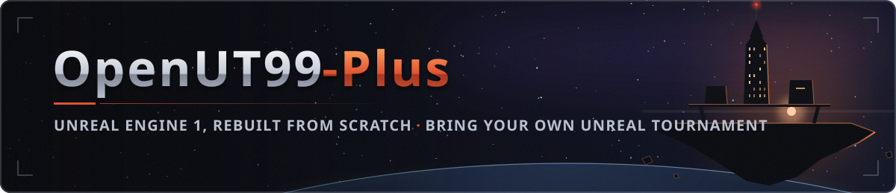
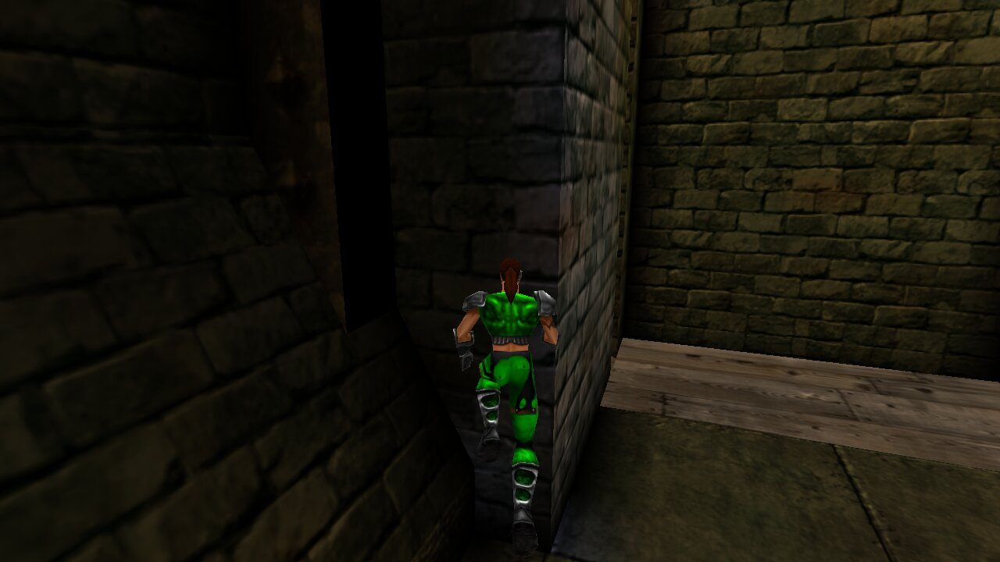

# OpenUT99-Plus

<p align="center"></p>


[](https://opengameplus.github.io/OpenUT99-Plus/)

[Español](README.es.md) · [English](README.md) · [Português](README.pt.md) · **Français** · [Deutsch](README.de.md) · [Русский](README.ru.md)

**Unreal Tournament sur un nouveau moteur.** OpenUT99-Plus est une réimplémentation indépendante de l'Unreal Engine 1, le moteur d'Unreal Tournament (1999), écrite de zéro. Il lit les fichiers du jeu depuis votre installation et les exécute sur les systèmes actuels, code UnrealScript du jeu compris. L'objectif à long terme est de jouer avec et contre le jeu original : des clients originaux sur notre serveur, et notre client sur des serveurs originaux.

<table>
  <tr>
    <td></td>
    <td></td>
  </tr>
  <tr>
    <td colspan="2"></td>
  </tr>
</table>
<p align="center"><sub>DM-Curse][, CTF-Coret et DM-Morpheus, dessinés par OpenUT99-Plus à partir des fichiers du jeu pendant que les bots jouent la partie.</sub></p>

## Ce qui fonctionne aujourd'hui

- **Chaque objet de l'installation est décodé à l'octet près** : les 396 paquets, avec leurs cartes, textures, sons, musiques, polices, maillages, animations et le bytecode UnrealScript, lus par les outils Python et vérifiés contre le moteur C++.
- **Les 83 cartes se chargent et s'affichent** : BSP texturé, lightmaps précalculées, ciels, décors, objets à ramasser et personnages animés.
- **L'UnrealScript du jeu tourne** : notre machine virtuelle exécute les 1 604 classes du jeu. Elle lance un Deathmatch sur chaque carte sans aucune erreur de script. Les bots parcourent le réseau de chemins, ouvrent les portes, prennent les ascenseurs, ramassent armes et objets, se battent, meurent, marquent des points et réapparaissent.
- **Une physique mesurée sur l'original** : nos propres scripts sondes tournent sur le serveur dédié original et enregistrent exactement comment les pawns se déplacent ([ADR 0008](docs/architecture/adr/0008-probe-the-original.md)). Les marches, les rampes praticables, la glissade sur les pentes raides, la limite des murs et le saut sur les rebords correspondent à l'original ; le début d'une glissade pas encore.

> [!NOTE]
> **Phase de recherche.** On peut jouer un Deathmatch contre les bots, survoler n'importe quelle carte ou regarder les bots jouer. Pas encore de son, de HUD, d'arme en main, de menus ni de réseau, et une bonne part de la physique et de l'IA reste provisoire ([dette connue](docs/roadmap/debt.md)).

> [!IMPORTANT]
> **Aucun contenu du jeu n'est inclus : apportez vos propres données.** Ce dépôt ne contient que du code source : ni paquets, ni cartes, ni textures, ni sons, ni musiques, ni exécutables. Le moteur les lit depuis une copie d'Unreal Tournament que **vous possédez légalement**, appelée ici `<UT99_DIR>`. Testé avec la version Steam et le patch 469f d'[OldUnreal](https://www.oldunreal.com/).

## Comment l'essayer

Il n'y a pas encore de version prête à l'emploi. Compilez le moteur (voir [Compilation](#compilation)) et indiquez-lui votre dossier Unreal Tournament, celui qui contient `Maps/` et `System/` :

```sh
build/ut_mapview "<UT99_DIR>" DM-Deck16][                    # survoler une carte
build/ut_mapview "<UT99_DIR>" DM-Morpheus --play --follow    # regarder les bots jouer, en suivant l'un d'eux
build/ut_mapview "<UT99_DIR>" DM-Deck16][ --player --mouse-free   # jouer un Deathmatch contre les bots
build/ut_script "<UT99_DIR>" --map DM-Codex 60               # sans fenêtre : une minute de partie, imprimée
```

| Commandes | |
|---|---|
| Regarder | maintenir un bouton de la souris et glisser, ou les flèches |
| Voler | WASD, shift va plus vite |
| En jeu (`--player`) | WASD déplace, la souris regarde, bouton gauche / droit tir / tir secondaire, Espace saute, Ctrl s'accroupit, 1-0 armes |
| Pendant une partie | F suit le bot suivant ; Échap quitte |

## Feuille de route

L'ordre et les critères de sortie sont dans [docs/roadmap/roadmap.md](docs/roadmap/roadmap.md) :

1. **Paquets et objets** (fait) : chaque objet de chaque paquet lu sans octet restant.
2. **Visionneuse de niveaux** (fait) : chaque carte du jeu dans le moteur C++.
3. **Jouabilité** (en cours) : acteurs, physique, armes, bots et modes de jeu, jusqu'à un Deathmatch contre des bots.
4. **Fidélité** : comparaison côte à côte avec l'original.
5. **Réseau** : un client original rejoint notre serveur, et notre client rejoint un serveur original.

## Pour contribuer

Toute aide compte : l'essayer et signaler ce qui ne va pas, le comparer au jeu original, ou du code. La documentation technique, en anglais, commence à [docs/README.md](docs/README.md) : formats de fichiers, décisions d'architecture et dette connue. [AGENTS.md](AGENTS.md) est le point d'entrée pour les agents de programmation IA.

## Compilation

C++17, CMake, SDL2 et OpenGL 3.3 (libepoxy). Sous Debian ou Ubuntu :

```sh
sudo apt install cmake g++ git pkg-config libsdl2-dev libepoxy-dev
cmake -S . -B build && cmake --build build -j
ctest --test-dir build
# -> build/ut_mapview (fenêtre), build/ut_script (sans fenêtre), build/ut_dump (inspecteur de paquets)
```

<details>
<summary><b>Outils Python</b></summary>

Lecteurs des formats du jeu, uniquement avec la bibliothèque standard de Python 3.

```sh
python3 tools/upkg.py "<UT99_DIR>/Maps/DM-Deck16][.unr"        # en-tête, noms, imports, exports
python3 tools/uprops.py --sweep "<UT99_DIR>"                     # lit chaque objet, comptes par classe
python3 -m unittest discover -s tools                            # tests
python3 tools/check_docs.py                                      # vérification de la documentation
```

</details>

<details>
<summary><b>Où se trouve quoi</b></summary>

| Chemin | Contenu |
|---|---|
| `engine` | Le moteur C++ : paquets, niveaux, collision, la VM UnrealScript, le monde (physique, IA, movers), le rendu et les exécutables |
| `tools` | Lecteurs Python des formats, la sonde qui mesure l'original, le vérificateur de documentation et leurs tests |
| `docs/formats` | Les spécifications des formats de fichiers |
| `docs/architecture` | Couches, frontières et décisions d'architecture (ADR) |
| `docs/roadmap` | La feuille de route et la dette connue |
| `docs/ai` | La couche mémoire pour les agents IA |

</details>

## Transparence

- **Qui le maintient :** OpenGamePlus. J'aime les vieux jeux, et je veux continuer à jouer à Unreal Tournament entre amis sur les systèmes actuels, avec un moteur ouvert que la communauté peut faire vivre.
- **Comment le travail est fait :** je travaille avec [Claude Code](https://claude.com/claude-code), l'assistant de programmation d'Anthropic. Le code et la documentation, y compris ce README et ses traductions, sont écrits avec son aide. Les commits faits ainsi portent une ligne `Co-Authored-By: Claude` dans leur message, ce qui permet de les repérer dans l'historique avec `git log`.
- **Code original :** aucun code du moteur original n'est copié dans ce dépôt, et ses binaires natifs ne sont pas désassemblés. Le moteur est écrit à partir des fichiers de données du jeu, de l'UnrealScript du jeu (lu pour comprendre le comportement, jamais copié), de l'observation du jeu original en fonctionnement et de documentation publique ([ADR 0004](docs/architecture/adr/0004-clean-room-sources.md)).
- **Ce qu'il n'est pas :** ce n'est pas un projet officiel et il n'est pas affilié à Epic Games. Il ne contient aucun fichier du jeu.

## Avis

Ceci est une réimplémentation indépendante de l'Unreal Engine 1. Elle n'est ni affiliée, ni autorisée, ni parrainée, ni approuvée par Epic Games, Inc. ou l'une de ses filiales.

« Unreal » et « Unreal Tournament » sont des marques d'Epic Games, Inc. Elles ne sont utilisées dans ce dépôt qu'à des fins d'identification et d'interopérabilité, pour décrire ce que le moteur exécute. Aucun droit n'est revendiqué sur ces marques.

Ce projet ne fournit pas de données de jeu protégées par le droit d'auteur et n'aide pas à en obtenir. Pour l'utiliser avec le vrai contenu du jeu, vous devez fournir les fichiers de données d'une copie d'Unreal Tournament que vous possédez légalement.

Si vous êtes titulaire de droits et pensez que quelque chose ici ne devrait pas être distribué, ouvrez une issue ou contactez le mainteneur et ce sera traité rapidement.

Les captures d'écran montrent du contenu d'Unreal Tournament, propriété d'Epic Games, Inc., à des fins d'identification uniquement.

## Licence

[GNU Affero General Public License v3.0](LICENSE). Quiconque distribue le moteur, ou fait tourner une version modifiée comme serveur réseau pour d'autres, doit en proposer le code source sous la même licence. Les bibliothèques tierces gardent la leur : SDL2 (zlib) et libepoxy (MIT).

## Remerciements

- [SDL](https://www.libsdl.org/) et [libepoxy](https://github.com/anholt/libepoxy)
- [OldUnreal](https://www.oldunreal.com/), qui maintient Unreal Tournament en vie avec ses patchs
- [ut99-mapgen](https://github.com/monteslu/ut99-mapgen) (MIT), utilisé pour construire les cartes de calibrage
- Epic Games, pour le jeu
