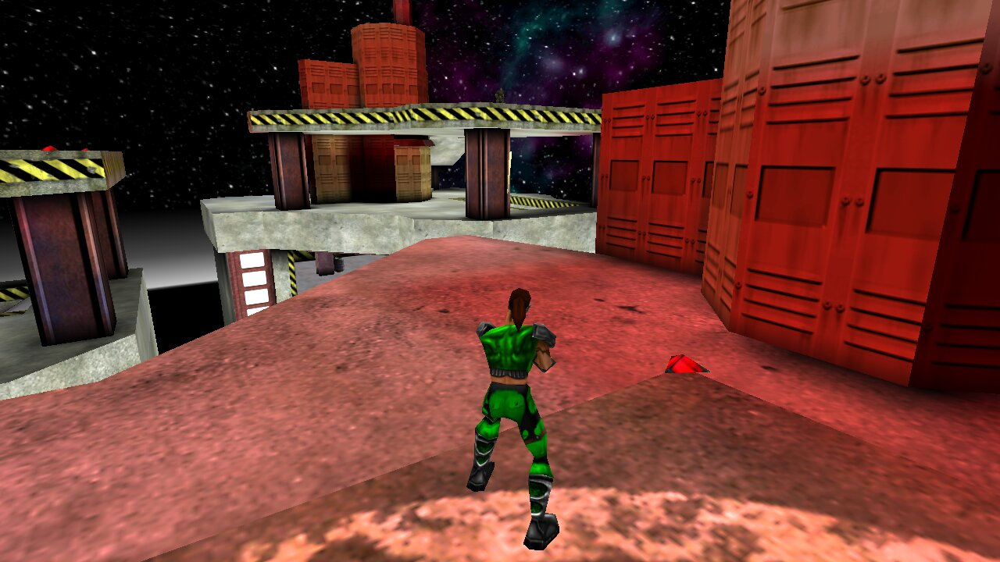

# OpenUT99-Plus

<p align="center"></p>


[Español](README.es.md) · **English** · [Português](README.pt.md) · [Français](README.fr.md) · [Deutsch](README.de.md) · [Русский](README.ru.md)

**Unreal Tournament on a new engine.** OpenUT99-Plus is an independent reimplementation of Unreal Engine 1, the engine of Unreal Tournament (1999), written from scratch. It reads the game's own files from your installation and runs them on modern systems, the game's UnrealScript code included. The long-term goal is to play with and against the original game: original clients on our server, and our client on original servers.

<table>
  <tr>
    <td></td>
    <td></td>
  </tr>
  <tr>
    <td colspan="2"></td>
  </tr>
</table>
<p align="center"><sub>DM-Curse][, CTF-Coret and DM-Morpheus, drawn by OpenUT99-Plus from the retail game files while bots play the match.</sub></p>

## What works today

- **Every object of the retail install is decoded byte-exactly**: all 396 packages, with their maps, textures, sounds, music, fonts, meshes, animations and the UnrealScript bytecode, read by the Python tools and checked against the C++ engine.
- **All 83 maps load and render**: textured BSP, baked lightmaps, skies, decorations, pickups and animated characters.
- **The game's own UnrealScript runs**: our virtual machine runs all 1,604 retail classes. It starts a Deathmatch on every map with no script error. Bots roam the path network, open doors, ride lifts, pick up weapons and items, fight each other, die, score and respawn.
- **Physics measured against the original**: our own probe scripts run on the original dedicated server and record exactly how pawns move ([ADR 0008](docs/architecture/adr/0008-probe-the-original.md)). Steps, walkable ramps, sliding on steep slopes, the wall limit and jumping onto ledges match it; how a slide starts does not yet.

> [!NOTE]
> **Research stage.** There is no player control yet: you can fly around any map or watch the bots play. There are no sound, HUD, menus or network yet, and much of the physics and AI is still placeholder ([known debt](docs/roadmap/debt.md)).

> [!IMPORTANT]
> **No game content is included — bring your own data.** This repository is source code only: no packages, maps, textures, sounds, music or executables. The engine reads them from a copy of Unreal Tournament that **you legally own**, referred to here as `<UT99_DIR>`. It was tested with the Steam release and the [OldUnreal](https://www.oldunreal.com/) 469f patch.

## How to try it

There are no ready-to-run builds yet. Build the engine (see [Building](#building)) and point it at your Unreal Tournament folder, the one with `Maps/` and `System/`:

```sh
build/ut_mapview "<UT99_DIR>" DM-Deck16][                    # fly through a map
build/ut_mapview "<UT99_DIR>" DM-Morpheus --play --follow    # watch the bots play, following one
build/ut_script "<UT99_DIR>" --map DM-Codex 60               # headless: one minute of a match, printed
```

| Controls | |
|---|---|
| Look | hold a mouse button and drag, or the arrow keys |
| Fly | WASD, shift goes faster |
| Watching a match | F follows the next bot; Esc quits |

## Roadmap

The order and exit checks are in [docs/roadmap/roadmap.md](docs/roadmap/roadmap.md):

1. **Packages and objects** (done): every object of every retail package read with no byte left over.
2. **Level viewer** (done): every retail map in the C++ engine.
3. **Gameplay** (in progress): actors, physics, weapons, bots and game types, up to a Deathmatch against bots.
4. **Fidelity**: side-by-side comparison with the original.
5. **Network**: an original client joins our server, and our client joins an original server.

## For contributors

Every kind of help counts: trying it and reporting what is wrong, comparing against the original game, or code. The technical documentation, in English, starts at [docs/README.md](docs/README.md): file formats, architecture decisions and known debt. [AGENTS.md](AGENTS.md) is the entry point for AI coding agents.

## Building

C++17, CMake, SDL2 and OpenGL 3.3 (libepoxy). On Debian or Ubuntu:

```sh
sudo apt install cmake g++ git pkg-config libsdl2-dev libepoxy-dev
cmake -S . -B build && cmake --build build -j
ctest --test-dir build
# -> build/ut_mapview (window), build/ut_script (headless), build/ut_dump (package inspector)
```

<details>
<summary><b>Python tools</b></summary>

Readers for the game's formats, Python 3 standard library only.

```sh
python3 tools/upkg.py "<UT99_DIR>/Maps/DM-Deck16][.unr"        # header, names, imports, exports
python3 tools/uprops.py --sweep "<UT99_DIR>"                     # parse every object, counts per class
python3 -m unittest discover -s tools                            # tests
python3 tools/check_docs.py                                      # documentation checks
```

</details>

<details>
<summary><b>What is where</b></summary>

| Path | Contents |
|---|---|
| `engine` | The C++ engine: packages, levels, collision, the UnrealScript VM, the world (physics, AI, movers), the renderer and the executables |
| `tools` | Python readers for the formats, the probe that measures the original, the documentation checker and their tests |
| `docs/formats` | The file format specifications |
| `docs/architecture` | Layers, boundaries and the architecture decisions (ADRs) |
| `docs/roadmap` | The roadmap and the known debt |
| `docs/ai` | The memory layer for AI agents |

</details>

## Transparency

- **Who maintains this:** OpenGamePlus. I like old games, and I want to keep playing Unreal Tournament with friends on today's systems, with an open engine the community can keep alive.
- **How the work is done:** I work with [Claude Code](https://claude.com/claude-code), Anthropic's coding assistant. The code and documentation, this README and its translations included, are written with its help. Commits made this way carry a `Co-Authored-By: Claude` line in their message, so they can be identified in the history with `git log`.
- **Original code:** no code of the original engine is copied into this repository, and its native binaries are not disassembled. The engine is written from the game's data files, from the game's own UnrealScript (read to understand behaviour, never copied), from observing the original game run, and from public documentation ([ADR 0004](docs/architecture/adr/0004-clean-room-sources.md)).
- **What it is not:** it is not an official project and is not affiliated with Epic Games. It contains no game files.

## Notice

This is an independent reimplementation of Unreal Engine 1. It is not affiliated with, authorized by, sponsored by, or endorsed by Epic Games, Inc., or any of its affiliates.

"Unreal" and "Unreal Tournament" are trademarks of Epic Games, Inc. They are used in this repository only for identification and interoperability, to describe what the engine runs. No claim is made to those marks.

This project does not provide or help obtain copyrighted game data. To use it with real game content, you must supply data files from a copy of Unreal Tournament that you legally own.

If you are a rights holder and believe something here should not be distributed, please open an issue or contact the maintainer and it will be addressed promptly.

The screenshots show content of Unreal Tournament, property of Epic Games, Inc., for identification only.

## License

[GNU Affero General Public License v3.0](LICENSE). Whoever distributes the engine, or runs a modified version as a network server for others, must offer its source under the same license. Third-party libraries keep theirs: SDL2 (zlib) and libepoxy (MIT).

## Credits

- [SDL](https://www.libsdl.org/) and [libepoxy](https://github.com/anholt/libepoxy)
- [OldUnreal](https://www.oldunreal.com/), for keeping Unreal Tournament alive with its patches
- [ut99-mapgen](https://github.com/monteslu/ut99-mapgen) (MIT), used to build the calibration maps
- Epic Games, for the game
